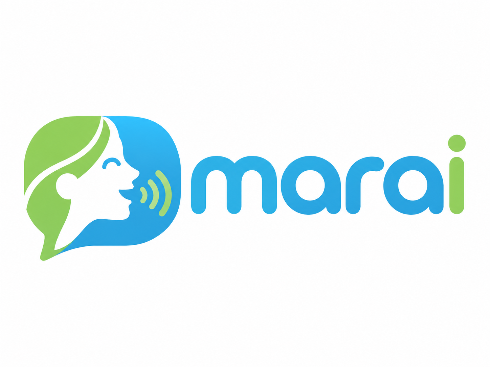
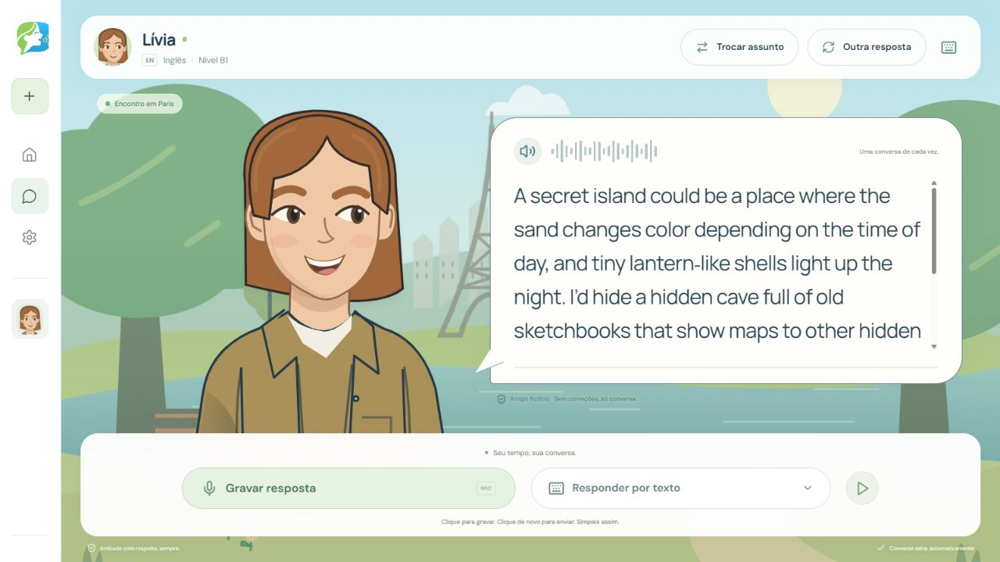
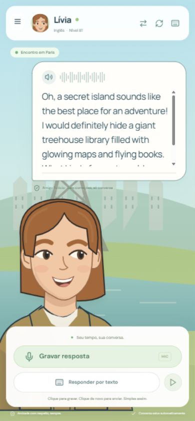

<div align="center">



# 🌍 Marai

**Practice languages through natural conversations with customizable AI characters.**


[Português](#-português) · [English](#-english)

</div>

<p align="center">
  
  
</p>

> **Availability:** Marai currently runs locally. There is no public hosted demo yet; screenshots are previews of the application.

---

## 🇧🇷 Português

### 📌 Sobre o projeto

O **Marai** é uma plataforma web para praticar idiomas por meio de **conversas naturais com personagens fictícios controlados por inteligência artificial**. Em vez de seguir roteiros rígidos ou realizar provas, o usuário cria um amigo virtual, escolhe seu idioma e nível de proficiência e pratica em situações de conversa aberta.

Cada personagem é representado por um **avatar 2D personalizável**, com aparência, identidade e personalidade próprias. A aplicação oferece conversação por texto e voz, cenários ilustrados e histórico persistente para retomar conversas anteriores.

### 🚀 Principais funcionalidades

- **Sete idiomas:** inglês, espanhol, francês, alemão, italiano, português e japonês.
- **Seis níveis CEFR:** A1, A2, B1, B2, C1 e C2.
- **Avatares 2D personalizáveis:** cabelo, rosto, olhos, roupas, cores e acessórios.
- **Identidades fictícias:** nome, interesses, traços de personalidade, profissão, origem e biografia.
- **Seis cenários:** parque, sala acolhedora, ilha de doces, Paris, parque dos sonhos e Kyoto.
- **Conversa por texto e voz:** gravação e prévia de áudio, transcrição de fala e respostas faladas.
- **Controles de reprodução:** pausar, continuar e reiniciar o áudio; solicitar outra resposta ou mudar de assunto.
- **Tradutor integrado:** consultas de palavras e frases via **MyMemory**, sem sair da conversa.
- **Contas e persistência:** personagens, sessões e histórico salvos no PostgreSQL.
- **Proteções de conteúdo:** validação de entradas, respostas e perfis dos personagens.

<p align="center">
  
</p>

### 🎮 Jornada do usuário

1. Escolha o idioma, o nível e o cenário da conversa.
2. Personalize a aparência e a identidade do seu amigo virtual.
3. Inicie a conversa por texto ou microfone e ouça as respostas da IA.
4. Utilize o tradutor e o histórico sempre que precisar, sem interromper a experiência.

O projeto tem foco na **prática natural de conversação**: não oferece pontuações, exames ou correção obrigatória de frases.

### 🛠️ Tecnologias e integrações

| Camada | Tecnologias |
| --- | --- |
| Frontend | React 19, TypeScript, Vite, CSS, SVG, Lucide React |
| Backend | Python 3.12+, FastAPI, Uvicorn, Pydantic |
| Banco de dados | PostgreSQL, SQLAlchemy, Alembic |
| Autenticação | Argon2id, cookies de sessão HttpOnly e OAuth Google opcional |
| IA conversacional | Google Gemini, com Groq como alternativa |
| Reconhecimento de voz | Whisper via Groq |
| Síntese de voz | Edge TTS e Gemini TTS opcional |
| Tradução | MyMemory Translation API |
| Testes e ferramentas | pytest, Vitest, Docker Compose |

A aplicação segue uma **arquitetura em camadas inspirada em MVVM**.

```text
Navegador (React + TypeScript)
               |
            HTTP /api
               |
      Backend (FastAPI)
         /          \
        /            \
 PostgreSQL      Serviços externos
 (local/Aiven)   Gemini · Groq
                 Edge TTS · MyMemory
```

O frontend apresenta a interface; o backend processa as operações e mantém as credenciais; o banco persiste usuários, personagens e mensagens.

### ⚙️ Como executar localmente

**Pré-requisitos (Windows):** Git, Python 3.12 ou superior, Node.js LTS com npm ou pnpm e Docker Desktop para o banco PostgreSQL local. O `uv` é opcional.

**1. Clone o repositório:**

```powershell
git clone https://github.com/RafaelPassosQueiroz/marai.git
cd marai
```

**2. Crie o arquivo de configurações:**

```powershell
Copy-Item .env.example .env
```

Edite o `.env` e informe suas próprias credenciais `GEMINI_API_KEY` e `GROQ_API_KEY`. As funcionalidades de IA e voz dependem de serviços externos e de conexão com a internet.

**3. Inicie o Docker Desktop** e execute `Iniciar Marai.cmd`, na raiz do projeto. O iniciador prepara as dependências, compila o frontend, aplica as migrações e inicia o backend.

**4. Abra:** **http://localhost:8001**

O backend utiliza a porta **8001**, o PostgreSQL local utiliza **5433**, e o servidor de desenvolvimento Vite utiliza **5173**. Para encerrar a aplicação, pressione `Ctrl+C` na janela do servidor.

**Banco remoto:** é possível utilizar PostgreSQL no **Aiven** em vez do container local, mediante configuração segura de `DATABASE_URL` e TLS. O repositório também inclui o script `Migrar para Aiven.cmd`; consulte o README anterior no histórico Git para as instruções detalhadas de migração antes de executá-lo.

### 🧪 Testes

Com o ambiente Python preparado:

```powershell
.\.venv\Scripts\python.exe -m pytest -q
cd frontend
pnpm test
pnpm build
```

Se estiver usando npm, substitua os dois últimos comandos por `npm test` e `npm run build`. Os testes automatizados utilizam substituições das APIs, sem exigir chamadas reais aos provedores de IA.

### 🔐 Segurança e limitações

- **Nunca publique** o arquivo `.env`, chaves Gemini/Groq, senhas, tokens ou credenciais do Aiven.
- Cada desenvolvedor que executar a versão local deve fornecer **suas próprias chaves de API**.
- Áudio e mensagens são enviados aos serviços externos necessários para IA, transcrição, voz e tradução; o Marai não é inteiramente offline.
- O login com Google requer credenciais OAuth independentes das chaves Gemini e Groq.
- O MyMemory impõe limites de tradução definidos pelo fornecedor.
- O projeto atualmente funciona em **ambiente local**; disponibilizá-lo publicamente exige configuração de HTTPS, autenticação, origens permitidas e limites de uso.

Consulte [VALIDACAO.md](VALIDACAO.md) para resultados e limitações dos testes e [GUIA_TECNOLOGIAS_MARAI.md](GUIA_TECNOLOGIAS_MARAI.md) para uma explicação mais aprofundada da arquitetura.

### 🎯 Objetivo

O Marai é um projeto de **aprendizado, experimentação e portfólio**, criado para explorar desenvolvimento full-stack, IA generativa, processamento de voz, persistência de dados e design de interfaces orientadas à experiência do usuário.

**Desenvolvido por [Rafael Passos Queiroz](https://github.com/RafaelPassosQueiroz).**

---

## 🇺🇸 English

### 📌 About the project

**Marai** is a web-based language practice platform built around **natural conversations with AI-driven fictional characters**. Instead of following fixed dialogues or taking quizzes, users create a virtual friend, choose a language and proficiency level, and practice through open-ended conversation.

Each character is represented by a **customizable 2D avatar** with a distinct appearance, background, and personality. Marai supports text and voice interactions, illustrated environments, and persistent conversation history.

### 🚀 Main features

- **Seven languages:** English, Spanish, French, German, Italian, Portuguese, and Japanese.
- **Six CEFR levels:** A1, A2, B1, B2, C1, and C2.
- **Customizable 2D avatars:** hair, face, eyes, outfits, colors, and accessories.
- **Fictional identities:** name, interests, personality traits, profession, background, and biography.
- **Six environments:** park, cozy room, candy island, Paris, dream park, and Kyoto.
- **Text and voice chat:** voice recording and preview, transcription, and spoken AI replies.
- **Playback controls:** pause, resume, and restart audio; regenerate a reply or switch topics.
- **Built-in translator:** word and phrase lookups using the **MyMemory** API.
- **Accounts and persistence:** saved characters, sessions, and conversation histories in PostgreSQL.
- **Content safeguards:** validation of user input, model output, and character profiles.

### 🎮 User journey

1. Select a language, proficiency level, and conversation setting.
2. Customize your virtual friend's appearance and identity.
3. Start chatting by typing or speaking, with AI-generated spoken responses.
4. Use the integrated translator and conversation history whenever needed.

Marai emphasizes **open-ended conversation practice**, not grading, tests, or automatic grammar correction.

### 🛠️ Technology stack

| Layer | Technologies |
| --- | --- |
| Frontend | React 19, TypeScript, Vite, CSS, SVG, Lucide React |
| Backend | Python 3.12+, FastAPI, Uvicorn, Pydantic |
| Database | PostgreSQL, SQLAlchemy, Alembic |
| Authentication | Argon2id, HttpOnly session cookies, optional Google OAuth |
| Conversational AI | Google Gemini with Groq fallback |
| Speech-to-text | Whisper via Groq |
| Text-to-speech | Edge TTS, optional Gemini TTS |
| Translation | MyMemory Translation API |
| Tests and tooling | pytest, Vitest, Docker Compose |

The system follows an **MVVM-inspired layered architecture**. The React frontend handles presentation; FastAPI manages authentication, business logic, and third-party integrations; and PostgreSQL stores persistent data. API keys stay on the backend.

### ⚙️ Running locally (Windows)

**Requirements:** Git, Python 3.12+, Node.js LTS with npm or pnpm, and Docker Desktop for a local PostgreSQL database. `uv` is optional.

**1. Clone the project:**

```powershell
git clone https://github.com/RafaelPassosQueiroz/marai.git
cd marai
```

**2. Create your environment configuration:**

```powershell
Copy-Item .env.example .env
```

Add your own `GEMINI_API_KEY` and `GROQ_API_KEY` to `.env`. AI and speech features require internet access and external providers.

**3. Start Docker Desktop** and run `Iniciar Marai.cmd` from the repository root. The launcher installs dependencies, builds the frontend, runs migrations, and starts the application.

**4. Open:** **http://localhost:8001**

The backend runs on port **8001**, local PostgreSQL on **5433**, and the Vite development server on **5173**. Use `Ctrl+C` to stop the server.

**Remote database:** PostgreSQL on **Aiven** is also supported by configuring `DATABASE_URL` and TLS correctly. The repository includes `Migrar para Aiven.cmd`; refer to the earlier README in Git history for detailed migration notes before using the script.

### 🧪 Running tests

After the Python environment has been initialized:

```powershell
.\.venv\Scripts\python.exe -m pytest -q
cd frontend
pnpm test
pnpm build
```

With npm, use `npm test` and `npm run build` instead of the pnpm commands. Automated tests use mocked AI responses and do not require live API calls.

### 🔐 Security and limitations

- **Never commit** `.env`, API keys, database passwords, or access tokens.
- Local installations require developers to configure **their own AI API keys**.
- AI, speech, and translation features rely on external providers; the application is not fully offline.
- Google sign-in requires separate OAuth credentials.
- MyMemory applies provider-side usage limits.
- The application currently runs **locally**; public deployment requires additional HTTPS, origin, cookie, and rate-limiting configuration.

See [VALIDACAO.md](VALIDACAO.md) for testing information and [GUIA_TECNOLOGIAS_MARAI.md](GUIA_TECNOLOGIAS_MARAI.md) for architecture details.

### 🎯 Purpose

Marai is a **learning, experimentation, and portfolio project** showcasing full-stack web development, generative AI, speech processing, persistent data, and user-centered interface design.

**Created by [Rafael Passos Queiroz](https://github.com/RafaelPassosQueiroz).**
